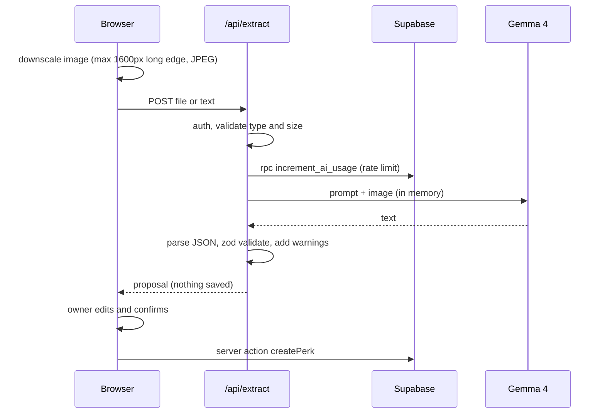
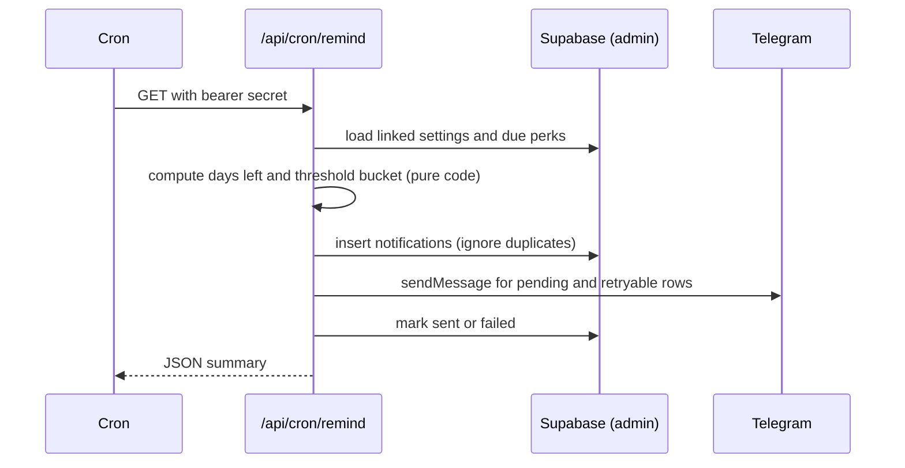

# 02. Architecture

## Components

| Component | Technology | Responsibility |
| --- | --- | --- |
| Web app | Next.js App Router, TypeScript, Tailwind | UI, server actions, route handlers |
| Auth | Supabase Auth (magic link) | Owner sign in, sessions |
| Database | Supabase Postgres + RLS | Perks, settings, notifications, AI usage |
| AI | `@google/genai` calling Gemma 4 | Extraction and the optional ask box |
| Notifications | Telegram Bot API over `fetch` | Reminders and bot commands |
| Scheduler | Vercel Cron (default) or `pg_cron` + `pg_net` | Daily reminder run |

## Allowed dependencies

Runtime: `next`, `react`, `react-dom`, `@supabase/supabase-js`, `@supabase/ssr`, `@google/genai`, `zod`, `server-only`, `lucide-react` (icons, optional).
Dev: `typescript`, `tailwindcss` (and its PostCSS plugin), `eslint` with the Next config, `vitest`, `tsx`, `@types/node`, `@types/react`.
Anything else needs a note under "Agent decisions" in `00-DECISIONS.md`.

## Project structure

```text
perkwatch/
  AGENTS.md
  README.md
  .env.example
  vercel.json
  docs/
  supabase/migrations/0001_init.sql
  scripts/
    set-telegram-webhook.ts
    eval-extract.ts
  eval/
    cases.json                 # extraction test cases (see 05)
    fixtures/                  # sample screenshots and emails (no real personal data)
  src/
    middleware.ts              # session refresh + route protection
    app/
      layout.tsx
      login/page.tsx
      auth/callback/route.ts
      (app)/
        layout.tsx             # nav, owner check
        page.tsx               # dashboard
        add/page.tsx           # capture + confirm
        perks/[id]/page.tsx    # view and edit
        settings/page.tsx
        ask/page.tsx           # Phase 4, optional
      actions/
        perks.ts               # server actions: create, update, setStatus, delete
        settings.ts            # server actions: update, createTelegramLink, unlinkTelegram
      api/
        extract/route.ts
        ask/route.ts
        telegram/webhook/route.ts
        cron/remind/route.ts
    components/
    lib/
      env.ts                   # zod-validated env, server and public separated
      supabase/{server.ts,client.ts,admin.ts,middleware.ts}
      perks/{schema.ts,status.ts,dates.ts,queries.ts,duplicates.ts}
      ai/{gemma.ts,extract.ts,prompts.ts,schemas.ts,json.ts,ask.ts}
      notify/{telegram.ts,reminders.ts,format.ts,link.ts}
      errors.ts                # error codes + response helper
  tests/
```

## Supabase clients

| Client | File | Key | Use |
| --- | --- | --- | --- |
| Server (user session) | `lib/supabase/server.ts` | anon key + cookies | Pages, server actions, `/api/extract`, `/api/ask` |
| Browser | `lib/supabase/client.ts` | anon key | Login form only |
| Admin | `lib/supabase/admin.ts` | service-role key | Cron route, Telegram webhook, `increment_ai_usage` RPC only. Starts with `import 'server-only'` |

Use `supabase.auth.getUser()` on the server, never `getSession()`, for authorization decisions.

## Auth and access

- The owner user is created manually in the Supabase dashboard. Signups are disabled there.
- The login form calls `signInWithOtp` with `shouldCreateUser: false`.
- `middleware.ts` refreshes the session and redirects unauthenticated requests to `/login`.
- Defense in depth: the `(app)` layout compares `user.email` to `OWNER_EMAIL` and signs out on mismatch.
- Public routes (own authentication): `/login`, `/auth/callback`, `/api/telegram/webhook` (secret header), `/api/cron/remind` (bearer secret).

## Flows

### Extract



### Remind



## Key technical rules

- Date logic uses `YYYY-MM-DD` strings and UTC date math. "Today" is computed in the owner's timezone with `Intl.DateTimeFormat` (see `lib/perks/dates.ts`).
- Upload limit is 4 MB (Vercel's request body limit is about 4.5 MB). The browser downscales before sending.
- The extract route sets a 25 second timeout for the model call.
- Cron is idempotent. Running it twice in a day sends nothing extra.

## Environment variables

See `.env.example`. `lib/env.ts` validates them with zod at startup: the server schema covers everything, the public schema covers only `NEXT_PUBLIC_*`. Missing required values fail fast with a clear message.

## Deployment

- Host: Vercel (default).
- `vercel.json`:

```json
{ "crons": [{ "path": "/api/cron/remind", "schedule": "0 3 * * *" }] }
```

- Schedule is UTC. Pick a time that is morning in the owner's timezone.
- Alternative scheduler: Supabase `pg_cron` calling the route with `pg_net` and the bearer header.
